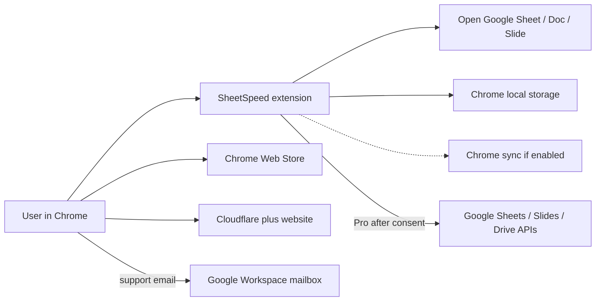

# SheetSpeed data map

**No spreadsheet, Doc or Slide content is sent to a SheetSpeed server.** Dressler Labs does not receive Google access tokens. Evidence: live Privacy Policy, DPA Annex A, `extension/background.js` and `extension/lib/google-api.js` at commit `2e2b338`.

A renderable copy is in `data-flow.mmd`. If an SVG or PNG is present beside this file, it was generated from that source.

## Data map

| Data element | Source | Where it is processed | Where it is stored | Retention | Who can access it | Vendor |
| --- | --- | --- | --- | --- | --- | --- |
| Visible formula text, selection, menu/control state (Sheets/Slides) | Open Google page | Content script in the user’s browser | Not stored, except as needed for the command in memory | For the command only | The user, on that device | None (local). The document itself stays in Google. |
| Docs menu, toolbar and key-tip state | Open Google Docs page | Content script in the user’s browser | Not stored; document text is not read, stored or sent | For the command only | The user, on that device | None (local) |
| Keyboard events (shortcut matching) | User input | Extension in the browser | At most the latest modifier/event metadata for local diagnostics on the device | Until cleared or overwrite | The user, on that device | None (local) |
| Spreadsheet cells, formulas, formatting used by a Pro tool | Google Sheets API, after consent | User’s browser; request goes to Google | Not on a SheetSpeed server. Undo snapshots may be stored locally (below) | Google retains the file under the user’s/org’s Google account | The user; Google as the user’s document host; not Dressler Labs | Google LLC (Sheets API) |
| Slide elements and temporary PNG for Refresh from Sheets | Google Slides and Drive APIs, after extra consent | User’s browser; brief anyone-with-link share on a temp Drive file | Temporary file in the **user’s** Drive, then deleted if cleanup succeeds | Intended to be minutes or less; leftovers possible if the browser dies mid-refresh | Anyone with the link while the share is active; then the user and Google | Google LLC (Slides, Drive) |
| Google access token | Chrome `identity` after consent | Used only in the browser to call Google APIs | Chrome-managed token cache, not a SheetSpeed server | Until disconnect, revoke, or Chrome clears it | The user, via Chrome; not Dressler Labs | Google LLC / Chrome |
| Shortcut settings, key-tip and QAT preferences | User in Settings | Extension | `chrome.storage.local`; also `chrome.storage.sync` key `gridpilotSettings` if the user enables sync | Until changed, cleared, or uninstall | The user (and other devices on that Chrome profile if sync is on) | Google Chrome sync, only if enabled — not a Dressler Labs subprocessor |
| Pro undo / recovery journals | Result of a Pro edit | Extension | `chrome.storage.local` (and related `transaction:` keys). Settings text says undo records expire after 30 days and are size-bounded | Until expiry, Clear undo history, or uninstall | The user, on that device | None (local) |
| Website visit technical data (IP, user-agent, URL, referrer) | Browser request to the site | Cloudflare edge, GitHub Pages origin, Google Fonts, Cloudflare Web Analytics | Vendor logs and analytics, under those vendors’ terms | Per those vendors’ policies | Dressler Labs (aggregate analytics); the vendors | Cloudflare, GitHub, Google Fonts |
| Support and procurement email | Sender to jarvis@agi-jarvis.com | Google Workspace | The operator’s Workspace mailbox | As needed to complete the request, then on request where law allows; billing records later as tax law requires | Philip Dressler (sole operator) | Google LLC (Workspace) |
| License email and plan status | User, once billing opens | ExtensionPay; payments at Stripe | ExtensionPay / Stripe; a local license cache in Chrome storage | As tax law requires for billing records | The operator, ExtensionPay, Stripe | ExtensionPay and Stripe — **not used during early access** |
| Chrome Web Store install / listing interactions | User on the Store | Google | Google’s Store systems; publisher may see aggregate stats | Per Google | Google; publisher sees aggregates, not spreadsheet content | Google LLC (Chrome Web Store) |

**Special cases not in the Store product:** a development-only local AI helper (DeepSeek via native messaging) exists in source and is **stripped from the Store package**. Customer content in the Store build is not sent to an AI model and is not used to train models (Privacy Policy).
